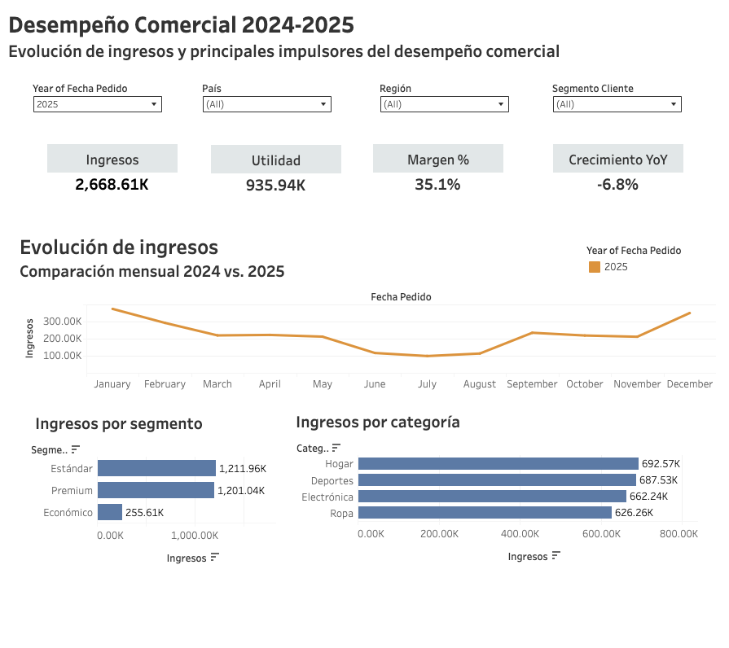
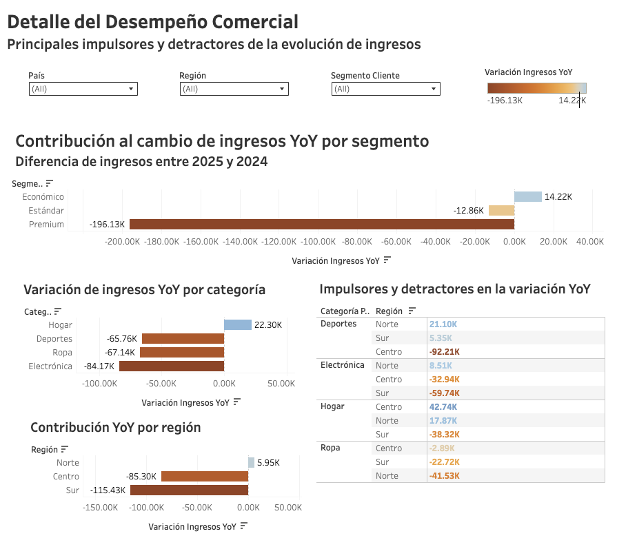

# Andes Retail Group: Dashboard de desempeño comercial 2024–2025

Caso de negocio simulado del bootcamp de Data Analytics de TripleTen. Los datos son de práctica.

## Pregunta de negocio
¿Cómo evolucionaron los ingresos entre 2024 y 2025, y qué explica la variación?

## Dashboard
[Ver en Tableau Public](https://public.tableau.com/views/Dashboard_Andes_Retail_Group_Tableau/DesempeoCcomercial2024-2025)

*Las capturas muestran el filtro en 2025. En el dashboard interactivo puedes comparar 2024 y 2025 y filtrar por país, región y segmento de cliente.*

## Indicadores de 2025
| Ingresos | Utilidad | Margen | Crecimiento YoY |
|---|---|---|---|
| 2,668.61 K | 935.94 K | 35.1% | −6.8% |

Los ingresos cayeron unos 194.8 K frente a 2024 (≈ 2,863.4 K).

## Narrativa con el modelo SCQA
Dividí la historia en dos páginas para no repetir información:
- **Overview (Situación y Complicación):** KPIs, evolución mensual de ingresos y composición por segmento y categoría. Su hallazgo principal es la caída de −6.8% interanual.
- **Detalle (Pregunta y Respuesta):** descompone esa caída por segmento, categoría y región, con una tabla que cruza categoría y región.

## Hallazgos
- **Segmento:** Premium explica toda la caída (−196.13 K). Económico crece (+14.22 K) y Estándar baja poco (−12.86 K).
- **Categoría:** Electrónica es la que más resta (−84.17 K), seguida de Ropa (−67.14 K) y Deportes (−65.76 K). Solo Hogar crece (+22.30 K).
- **Región:** Sur (−115.43 K) y Centro (−85.30 K) concentran la caída; Norte crece levemente (+5.95 K).
- **Focos puntuales:** el mayor retroceso es Deportes en la región Centro (−92.21 K), seguido de Electrónica en Sur (−59.74 K). Hogar en Centro es el principal impulsor (+42.74 K).

## Mensaje para el equipo (formato asincrónico)
> Equipo, como podrán observar en el Dashboard, el Andes Retail Group presenta un crecimiento interanual (YoY) de -6.8%, explicado principalmente por la contracción del segmento Premium, con Electrónica como principal categoría detractora y Sur/Centro como las regiones que concentran la mayor caída.

## Siguiente paso
Profundizar en las causas de la caída en Premium, Electrónica y Deportes en la región Centro, y definir acciones comerciales para cada una.

## Herramientas
Tableau · Modelo SCQA para narrativa de dashboards
